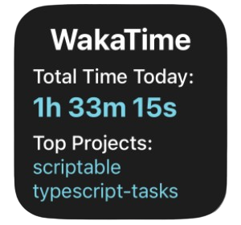
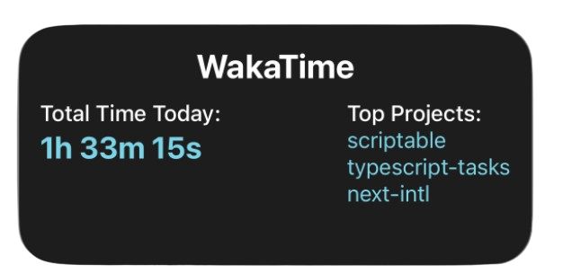

# WakaTime Widgets for Scriptable

A collection of iOS widgets for the [Scriptable](https://scriptable.app/) app that displays your [WakaTime](https://wakatime.com/) coding statistics directly on your home screen and lock screen.

## 📱 Available Widgets

### 1. onlyTime - Lock Screen Widget

Minimalist widget designed for the iOS lock screen showing only your total coding time for today.

**Size:** Small (1×1)  
**Best for:** Lock screen  
**Shows:** Total coding time (hours, minutes, seconds)


---

### 2. nameAndTime - Basic Widget

Simple widget displaying the WakaTime branding and your total coding time for today.

**Size:** Small (1×1)  
**Best for:** Home screen  
**Shows:**

- WakaTime header
- Total coding time today


---

### 3. timeAndProjects - Compact Projects Widget

Displays your total coding time and top projects you've worked on today.

**Size:** Small (1×1)  
**Best for:** Home screen  
**Shows:**

- WakaTime header
- Total coding time today
- Top 2 projects (configurable)



---

### 4. timeAndProjectsBig - Extended Projects Widget

Larger widget with more space for displaying additional projects and better readability.

**Size:** Medium (2×1)  
**Best for:** Home screen with more space  
**Shows:**

- WakaTime header
- Total coding time today
- Top 3 projects (configurable)
- Better layout with more spacing



## 🚀 Setup

### Prerequisites

- iOS device with iOS 14 or later
- [Scriptable app](https://apps.apple.com/us/app/scriptable/id1405459188) installed
- [WakaTime](https://wakatime.com/) account with API key

### Installation

1. **Get your WakaTime API Key:**
   - Go to [WakaTime Settings](https://wakatime.com/settings/account)
   - Copy your Secret API Key

2. **Install the widget:**
   - Open the Scriptable app
   - Create a new script
   - Copy the code from one of the widget files in the `widgets/` folder
   - Paste it into your new script
   - Replace `YOUR_WAKATIME_API_KEY` with your actual [API key](https://wakatime.com/settings/account#apikey)

3. **Configure timezone (optional):**
   - Find the `timeZone` variable in the code
   - Change it to your timezone (e.g., `"America/New_York"`, `"Asia/Tokyo"`)
   - See [MDN DateTimeFormat](https://developer.mozilla.org/en-US/docs/Web/JavaScript/Reference/Global_Objects/Intl/DateTimeFormat/DateTimeFormat) for reference

4. **Add widget to home screen:**
   - Long press on your home screen
   - Tap the "+" button in the top-left corner
   - Search for "Scriptable"
   - Choose widget size (Small for 1×1, Medium for 2×1)
   - Place the widget and tap on it
   - Select your script

## ⚙️ Configuration

### API Key

```javascript
const apiKey = "YOUR_WAKATIME_API_KEY";
```

### Colors

All widgets support color customization:

```javascript
const backgroundColor = new Color("#1d1d1d");
const titleColor = new Color("#ffffff");
const timeTextColor = new Color("#79d4e6");
```

### Timezone

```javascript
const timeZone = "Europe/Moscow";
```

### Number of Projects (timeAndProjects & timeAndProjectsBig)

```javascript
const n = 2; // or 3 for timeAndProjectsBig
```

## 📊 Features

- ✅ Real-time WakaTime statistics
- ✅ Automatic timezone support
- ✅ Project tracking with duration breakdown
- ✅ Clean, modern design
- ✅ Customizable colors
- ✅ Multiple widget sizes
- ✅ Lock screen support
- ✅ Error handling with fallbacks

## 🛠 Troubleshooting

### Widget shows "Error"

- Verify your API key is correct
- Check your internet connection
- Make sure WakaTime is tracking your coding activity

### No projects showing

- Ensure you've coded today
- Check that your editor is connected to WakaTime
- Verify the project name is not empty in WakaTime

### Wrong timezone

- Update the `timeZone` variable to match your location
- Use valid IANA timezone identifiers

## 📝 License

This project is open source and available under the MIT License.

## 🤝 Contributing

Contributions, issues, and feature requests are welcome!

## 💡 Credits

Built with [Scriptable](https://scriptable.app/) for iOS  
Data powered by [WakaTime](https://wakatime.com/)

---

**Note:** These widgets fetch data from WakaTime's public API. Make sure to keep your API key secure and don't share it publicly.
