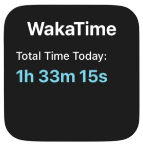

# WakaTime Widgets for Scriptable

A collection of iOS widgets for the [Scriptable](https://scriptable.app/) app that displays your [WakaTime](https://wakatime.com/) coding statistics directly on your home screen and lock screen.

## 📱 Available Widgets

### 1. onlyTime - Lock Screen Widget

Minimalist widget designed for the iOS lock screen showing only your total coding time for today.

**Size:** Small (1×1)  
**Best for:** Lock screen  
**Shows:** Total coding time (hours, minutes, seconds)


---

### 2. nameAndTime - Basic Widget

Simple widget displaying the WakaTime branding and your total coding time for today.

**Size:** Small (1×1)  
**Best for:** Home screen  
**Shows:**

- WakaTime header
- Total coding time today



> **Note:** Due to recent WakaTime API changes, standard API keys are now write-only. We migrated to Embeddable JSON links, which intentionally hide project names for privacy reasons.

## 🚀 Setup

### Prerequisites

- iOS device with iOS 14 or later
- [Scriptable app](https://apps.apple.com/us/app/scriptable/id1405459188) installed
- [WakaTime](https://wakatime.com/) account

### Installation

1. **Get your WakaTime Embeddable Code:**
   - Go to [WakaTime Settings] and get your Embeddable Charts (https://wakatime.com/share/embed)
   - **Important:** select JSON format
   - Get your Embeddable Code (copy only `url` string)

2. **Install the widget:**
   - Open the Scriptable app
   - Create a new script
   - Copy the code from one of the widget files in the `widgets/` folder
   - Paste it into your new script
   - Replace `YOUR_WAKATIME_EMBEDDABLE_CODE` (on line 1) with your actual [Embeddable Code](https://wakatime.com/share/embed)

3. **Add widget to home screen:**
   - Long press on your home screen
   - Tap the "+" button in the top-left corner
   - Search for "Scriptable"
   - Choose widget size (Small for 1×1, Medium for 2×1)
   - Place the widget and tap on it
   - Select your script

## ⚙️ Configuration

### Embeddable Code

```javascript
const embeddableCode = "YOUR_WAKATIME_EMBEDDABLE_CODE";
```

### Colors

All widgets support color customization:

```javascript
const backgroundColor = new Color("#1d1d1d");
const titleColor = new Color("#ffffff");
const timeTextColor = new Color("#79d4e6");
```

## 📊 Features

- ✅ Real-time WakaTime statistics
- ✅ Clean, modern design
- ✅ Customizable colors
- ✅ Multiple widget sizes
- ✅ Lock screen support
- ✅ Error handling with fallbacks

## 🛠 Troubleshooting

### Widget shows "Error"

- Verify your Embeddable Code is correct
- Check your internet connection
- Make sure WakaTime is tracking your coding activity

## 📝 License

This project is open source and available under the MIT License.

## 🤝 Contributing

Contributions, issues, and feature requests are welcome!

## 💡 Credits

Built with [Scriptable](https://scriptable.app/) for iOS  
Data powered by [WakaTime](https://wakatime.com/)

---

**Note:** These widgets fetch data from WakaTime's public API. Make sure to keep your Embeddable JSON URL private so others can't see your stats.
